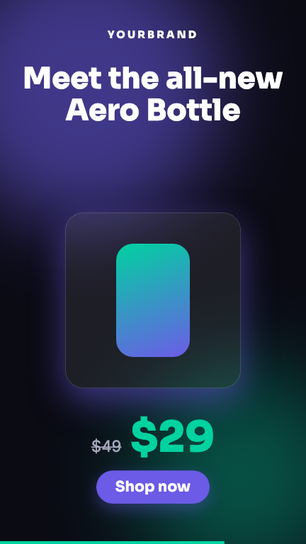
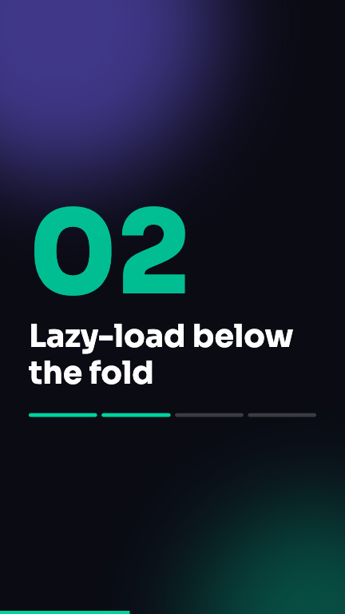

# remotion-promo-templates

Reusable, props-driven promo video templates built with [Remotion](https://www.remotion.dev) 4, React and TypeScript. Every template is described by a zod schema, so you can edit props visually in Remotion Studio or fill them from JSON in an automation (n8n, Make, a cron job, your own backend).

Built by [Saizul Amin](https://saizul.com). MIT licensed.

No copyrighted music, brand assets or non-redistributable fonts are included. Fonts (Inter, Sora) come from Google Fonts through `@remotion/google-fonts`, and all graphics are plain shapes.

## Templates

| Composition    | Size      | Duration | Use case                                         |
| -------------- | --------- | -------- | ------------------------------------------------ |
| `ProductPromo` | 1080x1920 | 15 s     | Headline, product image URL, price, CTA, colors  |
| `ServiceAd`    | 1080x1080 | 12 s     | Logo text, headline, 3 animated benefits, CTA    |
| `YouTubeIntro` | 1920x1080 | 6 s      | Kinetic title and subtitle                       |
| `BlogToReel`   | 1080x1920 | 20 s     | Blog title plus 3 to 5 key points, for Reels     |

All run at 30 fps. Colors (`primaryColor`, `accentColor`, `backgroundColor`, `textColor`) are props on every template; defaults live in `src/theme.ts`.

## Previews

| ProductPromo | ServiceAd | YouTubeIntro | BlogToReel |
| --- | --- | --- | --- |
|  |  |  |  |

## Quick start

```bash
npm install
npm run dev        # opens Remotion Studio, edit props in the sidebar
npm run typecheck
```

## Rendering from JSON

```bash
node scripts/render-from-json.mjs <CompositionId> <props.json> [output] [--still [frame]]

node scripts/render-from-json.mjs ProductPromo props/product-promo.json out/promo.mp4
node scripts/render-from-json.mjs BlogToReel props/blog-to-reel.json --still 225
```

Shortcuts: `npm run render:product`, `render:service`, `render:intro`, `render:reel`. The script wraps `npx remotion render` (or `remotion still`) with `--props=<file>`. Example inputs are in `props/`. Missing props fall back to the schema defaults.

### Props reference

- `ProductPromo`: `headline`, `productImageUrl`, `price`, `oldPrice`, `cta`, `brand`
- `ServiceAd`: `logoText`, `headline`, `benefits` (exactly 3), `cta`
- `YouTubeIntro`: `title`, `subtitle`
- `BlogToReel`: `title`, `points` (3 to 5), `cta`, `source`

## Automating with n8n

Remotion renders need Node and Chromium, so run them on a machine you control (a VPS works well) with this repo installed.

**Execute Command approach (n8n on the same host)**

1. Generate content upstream (for example, an LLM node that turns a blog post into a title and 4 points).
2. A Code node builds the props object. A Write Binary File node saves it as `/tmp/props-{{$json.id}}.json`.
3. An Execute Command node runs:
   ```bash
   cd /opt/remotion-promo-templates && node scripts/render-from-json.mjs BlogToReel /tmp/props-{{$json.id}}.json out/{{$json.id}}.mp4
   ```
4. A Read Binary File node loads `out/<id>.mp4` and passes it to YouTube, Instagram, Drive, etc.

**HTTP approach (n8n elsewhere)**

Wrap the script in a small service (for example an Express endpoint that accepts `{composition, props}`, writes the JSON to a temp file, spawns the script and streams back the MP4). Then use an n8n HTTP Request node to POST the JSON and receive the file. Protect the endpoint with a secret header, and validate props with the zod schemas in `src/schemas.ts`.

Product images must be reachable URLs when rendering (`productImageUrl`).

## Project layout

```
src/
  Root.tsx          composition registry (sizes, durations, schemas)
  schemas.ts        zod schemas and prop types
  theme.ts          colors, Google Fonts, spring presets
  components.tsx    shared background, CTA button, progress bar
  compositions/     the four templates
props/              example JSON inputs
scripts/            render-from-json.mjs
```

## License

MIT, see [LICENSE](LICENSE). Copyright (c) 2026 Saizul Amin.
